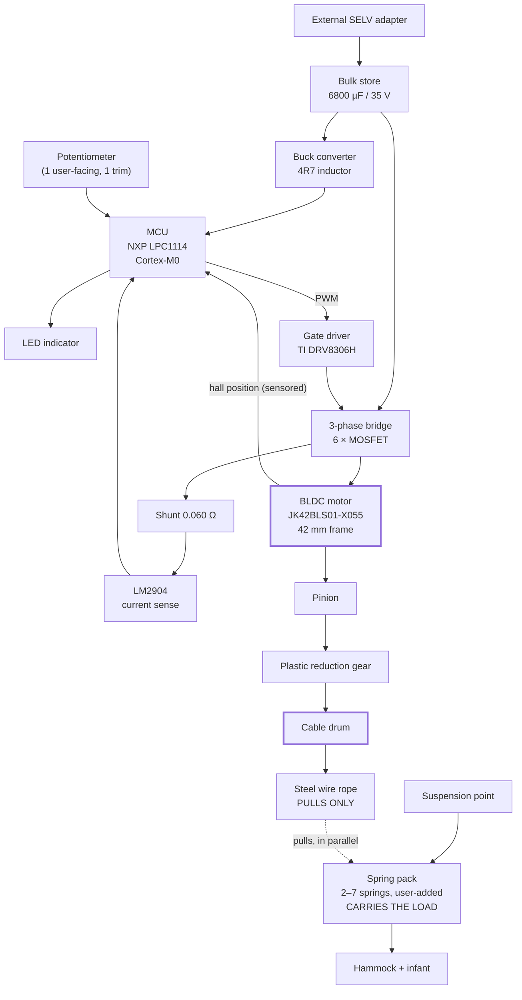

# Competitor A teardown — findings

```
Date:     2026-08-05
Unit:     Competitor A (owner's unit, in service)
Evidence: photographs held locally only — deliberately not in git, see PUBLISHING.md
Status:   first pass, from photographs only — nothing here has been measured
```

This answers the question [TS-001](../../../docs/05-trade-studies/TS-001-actuation-concept.md)
called its largest avoidable gap: **how the incumbent achieves quiet actuation**.

!!! note "The photographs are not in this repository"
    They are held locally by the owner and are gitignored, because publishing photographs of
    another company's internals is the largest exposure in this project. **This document is the
    deliverable** — the part numbers, the architecture and the diagrams below carry the engineering
    value without the images. See `PUBLISHING.md`.

---

## Identified parts

| What | Marking | Reading | Confidence |
|---|---|---|---|
| Motor | `BLDC MOTOR / JK42BLS01-X055` | Brushless DC, 42 mm (NEMA 17) frame | **High** — label is explicit |
| Gate driver | `DRV8306H TI` (U300) | TI three-phase BLDC smart gate driver, hardware-interface (non-SPI) variant | **High** — legible |
| MCU | `LPC1114F` | NXP LPC1114, ARM Cortex-M0 | **High** |
| Op-amp | `LM2904` (U301) | Dual op-amp — current-sense conditioning | **High** |
| Shunt | `R060` (R307) | 0.060 Ω current sense | **High** |
| Bulk capacitor | `6800 µF 35 V` | Electrolytic, energy reservoir | **High** |
| Power MOSFETs | SOIC-8, unread | Presumed 3 × dual N-channel = 6 FETs for the 3-phase bridge | **Medium** — inferred from the driver |
| Buck inductor | `4R7` | 4.7 µH — switching regulator for logic rail | **High** |
| Controls | 2 × panel potentiometer | `P1`, `P2` on silkscreen; only one user-facing | **High** |
| PCB | `HS M 94V-0 E315835 / H19003-5 / 2128` | UL 94V-0 laminate; `2128` reads as a 2021 date code | Medium |

## The mechanism

From the winch photograph: a **motorised cable winch**.

A small black pinion on the motor shaft drives a **large white plastic reduction gear**, which is
integral with a **cable drum**. A **steel wire rope** is wound on the drum and runs down through a
slotted metal bracket toward the spring pack and hammock.

So the actuator **modulates the effective suspension length** by winding and unwinding cable —
which is exactly the *"linear actuator in the load path"* concept listed in
[TS-001](../../../docs/05-trade-studies/TS-001-actuation-concept.md), implemented rotationally.

## Block diagram



### The load path as photographed

```
   ceiling / stand
         │
      carabiner
         │
   ┌─────┴──────────────────────────────┐
   │  housing                           │
   │                                    │
   │   [BLDC] ─ pinion ─▶ ( gear )      │   ← plastic reduction gear
   │                       ││           │
   │                    ( drum )        │   ← steel rope wound on drum
   │                       ││           │
   └───────────────────────┼┼───────────┘
                           ││ steel wire rope
                    ───────┼┼───────  slotted metal bracket
                           ││
                        ▓▓▓▓▓▓          ← spring pack (2-7 springs)
                           ││
                       hammock + infant

   CONFIRMED by owner: the SPRINGS carry the load. The rope only PULLS them.
   The gear train is in PARALLEL with the load path, not in series.
```

## What this tells us

**Quiet actuation is a sensored BLDC with a plastic reduction gear.** No exotic technology. A
brushless motor has no brushes to wear or arc, which also satisfies the continuous-duty
requirement that a brushed motor would struggle with. Plastic gears are quiet and self-damping.

**The drive is impulsive, and the 6800 µF proves it.** A capacitor that large on a small appliance
is an energy reservoir: the motor draws a large burst to pull the cable during part of the cycle,
and the capacitor recharges slowly from the adapter in between. That is how the average draw stays
near 5 W while peak motor current is much higher — and it corroborates the owner's "soft whir once
per bounce cycle". This directly confirms the speculation in
[power-tree.md](../../../docs/02-architecture/power-tree.md) that the drive rail would see low duty
cycle with high peaks.

**Sensing appears to be done entirely through the motor.** No accelerometer, load cell or separate
position encoder is visible. Rotor position from hall sensors gives drum angle, and therefore cable
position, for free. The 0.060 Ω shunt plus LM2904 gives motor current, and therefore torque, and
therefore an inference of load. If confirmed, this is a significant finding for
[TS-004](../../../docs/05-trade-studies/TS-004-sensing-approach.md): the incumbent gets amplitude,
position and occupancy without a single dedicated sensor.

**The electronics are economical.** A Cortex-M0, a hardware-configured gate driver with no SPI,
two pots and an LED.

We could not identify a safety monitor independent of the MCU in these photographs. **That is an
observation about what the images show, not a conclusion about the product.** Such a function could
be implemented inside the MCU, in a part we did not photograph or could not read, or in a way not
visible externally. Nothing here should be read as a safety criticism of a shipped, presumably
conformity-assessed product, and nothing here has been tested.

## Impact on our project

| Our position | What the teardown says |
|---|---|
| [TS-001](../../../docs/05-trade-studies/TS-001-actuation-concept.md) actuation concept undecided | A working, quiet, shipped answer exists: sensored BLDC + reduction gear + cable drum |
| [TS-004](../../../docs/05-trade-studies/TS-004-sensing-approach.md) sensing undecided | Motor-intrinsic sensing may remove the need for dedicated sensors entirely |
| [SAF-005](../../../docs/01-requirements/safety-requirements.md#saf-005) independent drive disable | None identifiable in the photographs; inconclusive |
| [HW-001](../../../docs/01-requirements/srs-electrical.md#hw-001) nominal voltage `TBD-P4` | Owner has set **12 V** for our design; incumbent may run higher |
| Bulk storage sizing "depends on the actuation concept" | Confirmed: 6800 µF for an impulsive drive |

**This is evidence about a competitor, not a decision about our product.** It informs the trade
studies; it does not shortcut them.

## Resolved by the owner (2026-08-05)

| Question | Answer |
|---|---|
| Does the rope carry the infant's weight? | **No.** The springs carry the load; the rope only pulls them. See below — this is the most important finding of the teardown. |
| Sensored or sensorless commutation? | **Sensored.** Hall sensors confirmed, so rotor position — and therefore drum angle and cable position — is available to the MCU. |
| Two potentiometers? | Only one is user-facing. The second is presumed an internal trim. **Our product will expose a single dial.** |
| Rail voltage | The 35 V capacitor does hint the incumbent runs higher, but **our design targets a 12 V rail** by decision. |

## The architecture insight: the actuator is not in the load path

This is the single most valuable thing learned from the teardown, and it is a *safety
architecture* choice rather than a mechanical detail.

```
        suspension point
              │
    ┌─────────┴──────────┐
    │                    │
  SPRINGS            ROPE + DRUM + GEAR + MOTOR
  carry the load     pull the springs
    │                    │
    └─────────┬──────────┘
              │
       hammock + infant

  LOAD PATH  = springs only, purely mechanical, n-way redundant
  DRIVE PATH = motor, gear, drum, rope - in PARALLEL, carries no static load
```

**Consequences:**

- **No actuator failure can drop the infant.** A stripped gear tooth, a snapped rope, a seized
  drum, a shorted MOSFET or dead firmware causes *loss of function*, never loss of load. The unit
  stops bouncing and hangs there.
- The plastic gear is therefore an acceptable choice in a product carrying a baby — it would not
  be if it were in series.
- No brake, ratchet or self-locking element is needed to hold the load unpowered, because the
  drive never holds the load.
- Redundancy in the load path reduces to redundancy **in the springs**, which is exactly what the
  multi-spring pack provides — and it explains why the pack can serve both load adaptation and
  fault tolerance without conflict.

This is a principle worth adopting outright rather than re-deriving: see
[IDEA-004](../../ideas/IDEA-004-actuator-parallel-to-load-path.md).

## How it actually operates *(observed)*

Turning the dial on does **not** start the hammock. The parent **taps the hammock by hand**; the
unit detects the resulting oscillation and sustains it at the level set by the dial.

This is the missing piece of the control architecture:

- **No resonance search is needed.** The tap excites the system at its own natural frequency; the
  unit only has to recognise motion and phase-lock to it
- **The motor is the sensor.** A bouncing hammock pulls the rope, turns the drum and back-drives
  the motor. Hall sensors work at zero speed, so the tap is detectable while the drive is idle —
  this is very likely *why* the motor is sensored rather than sensorless
- **It cannot start by itself**, which makes unexpected restart after a power interruption
  structurally impossible rather than a matter of firmware
- The "soft whir once per bounce cycle" now makes complete sense: detect phase, pulse, coast

## Remaining open

- Spring rate, free length and count
- Where exactly the rope terminates — does it pull the top of the spring stack, or the load below it?
- Motor gear ratio, and drum diameter — needed to convert motor revolutions to cable travel
- Whether any independent safety monitor exists that the photographs do not show
