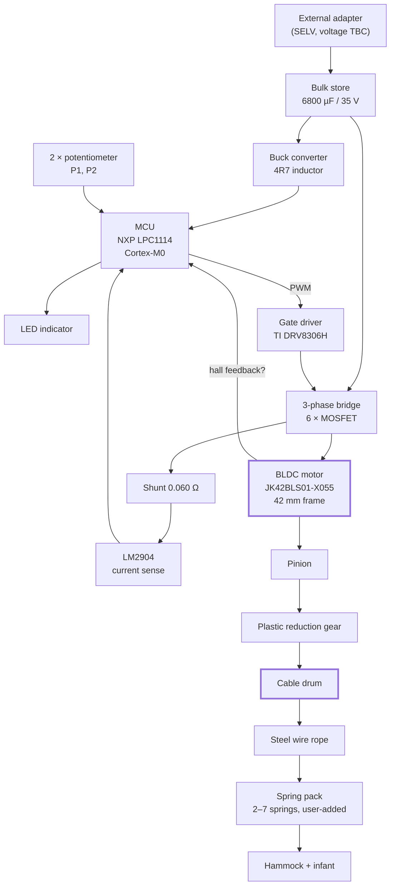

# Competitor A teardown — findings

```
Date:     2026-08-05
Unit:     Competitor A (owner's unit, in service)
Evidence: photographs in this directory
Status:   first pass, from photographs only — nothing here has been measured
```

This answers the question [TS-001](../../../docs/05-trade-studies/TS-001-actuation-concept.md)
called its largest avoidable gap: **how the incumbent achieves quiet actuation**.

---

## Identified parts

| What | Marking | Reading | Confidence |
|---|---|---|---|
| Motor | `BLDC MOTOR / JK42BLS01-X055` | Brushless DC, 42 mm (NEMA 17) frame | **High** — label is explicit |
| Gate driver | `DRV8306H TI` (U300) | TI three-phase BLDC smart gate driver, hardware-interface (non-SPI) variant | **High** — legible |
| MCU | `LPC1114F` | NXP LPC1114, ARM Cortex-M0 | **High** |
| Op-amp | `LM2904` (U301) | Dual op-amp — current-sense conditioning | **High** |
| Shunt | `R060` (R307) | 0.060 Ω current sense | **High** |
| Bulk capacitor | `6800 µF 35 V` | Electrolytic, energy reservoir | **High** |
| Power MOSFETs | SOIC-8, unread | Presumed 3 × dual N-channel = 6 FETs for the 3-phase bridge | **Medium** — inferred from the driver |
| Buck inductor | `4R7` | 4.7 µH — switching regulator for logic rail | **High** |
| Controls | 2 × panel potentiometer | `P1`, `P2` on silkscreen | **High** — but see questions |
| PCB | `HS M 94V-0 E315835 / H19003-5 / 2128` | UL 94V-0 laminate; `2128` reads as a 2021 date code | Medium |

## The mechanism

From `coilPulsHammock.jpg`: a **motorised cable winch**.

A small black pinion on the motor shaft drives a **large white plastic reduction gear**, which is
integral with a **cable drum**. A **steel wire rope** is wound on the drum and runs down through a
slotted metal bracket toward the spring pack and hammock.

So the actuator **modulates the effective suspension length** by winding and unwinding cable —
which is exactly the *"linear actuator in the load path"* concept listed in
[TS-001](../../../docs/05-trade-studies/TS-001-actuation-concept.md), implemented rotationally.

## Block diagram



### The load path as photographed

```
   ceiling / stand
         │
      carabiner
         │
   ┌─────┴──────────────────────────────┐
   │  housing                           │
   │                                    │
   │   [BLDC] ─ pinion ─▶ ( gear )      │   ← plastic reduction gear
   │                       ││           │
   │                    ( drum )        │   ← steel rope wound on drum
   │                       ││           │
   └───────────────────────┼┼───────────┘
                           ││ steel wire rope
                    ───────┼┼───────  slotted metal bracket
                           ││
                        ▓▓▓▓▓▓          ← spring pack (2-7 springs)
                           ││
                       hammock + infant

   ??? OPEN QUESTION: is the rope in series with the load (so the plastic gear
       train carries the infant), or in parallel with springs that carry it?
```

## What this tells us

**Quiet actuation is a sensored BLDC with a plastic reduction gear.** No exotic technology. A
brushless motor has no brushes to wear or arc, which also satisfies the continuous-duty
requirement that a brushed motor would struggle with. Plastic gears are quiet and self-damping.

**The drive is impulsive, and the 6800 µF proves it.** A capacitor that large on a small appliance
is an energy reservoir: the motor draws a large burst to pull the cable during part of the cycle,
and the capacitor recharges slowly from the adapter in between. That is how the average draw stays
near 5 W while peak motor current is much higher — and it corroborates the owner's "soft whir once
per bounce cycle". This directly confirms the speculation in
[power-tree.md](../../../docs/02-architecture/power-tree.md) that the drive rail would see low duty
cycle with high peaks.

**Sensing appears to be done entirely through the motor.** No accelerometer, load cell or separate
position encoder is visible. Rotor position from hall sensors gives drum angle, and therefore cable
position, for free. The 0.060 Ω shunt plus LM2904 gives motor current, and therefore torque, and
therefore an inference of load. If confirmed, this is a significant finding for
[TS-004](../../../docs/05-trade-studies/TS-004-sensing-approach.md): the incumbent gets amplitude,
position and occupancy without a single dedicated sensor.

**The electronics are modest and cheap.** A Cortex-M0, a hardware-configured gate driver with no
SPI, two pots and an LED. There is no evidence of a safety monitor independent of the MCU — which
is a notable difference from our
[safety concept](../../../docs/03-safety/safety-concept.md), and worth confirming.

## Impact on our project

| Our position | What the teardown says |
|---|---|
| [TS-001](../../../docs/05-trade-studies/TS-001-actuation-concept.md) actuation concept undecided | A working, quiet, shipped answer exists: sensored BLDC + reduction gear + cable drum |
| [TS-004](../../../docs/05-trade-studies/TS-004-sensing-approach.md) sensing undecided | Motor-intrinsic sensing may remove the need for dedicated sensors entirely |
| [SAF-005](../../../docs/01-requirements/safety-requirements.md#saf-005) independent drive disable | No independent monitor visible in the incumbent — our requirement may exceed the category norm |
| [HW-001](../../../docs/01-requirements/srs-electrical.md#hw-001) 12 V nominal | 35 V-rated bulk capacitor raises the question of whether the rail is actually higher |
| Bulk storage sizing "depends on the actuation concept" | Confirmed: 6800 µF for an impulsive drive |

**This is evidence about a competitor, not a decision about our product.** It informs the trade
studies; it does not shortcut them.

## Open questions

1. **Does the steel rope carry the infant's full weight?** If so, the plastic gear train is in the
   load path and a tooth failure drops the baby. Safety-critical to resolve.
2. Is the motor sensored (hall wires present) or is commutation sensorless?
3. What are the two potentiometers for? The owner reports only one user-facing dial.
4. What is the adapter's actual output voltage?
5. Is there any mechanical brake, ratchet or self-locking element holding the load when unpowered?
6. Spring rate, free length and count.
