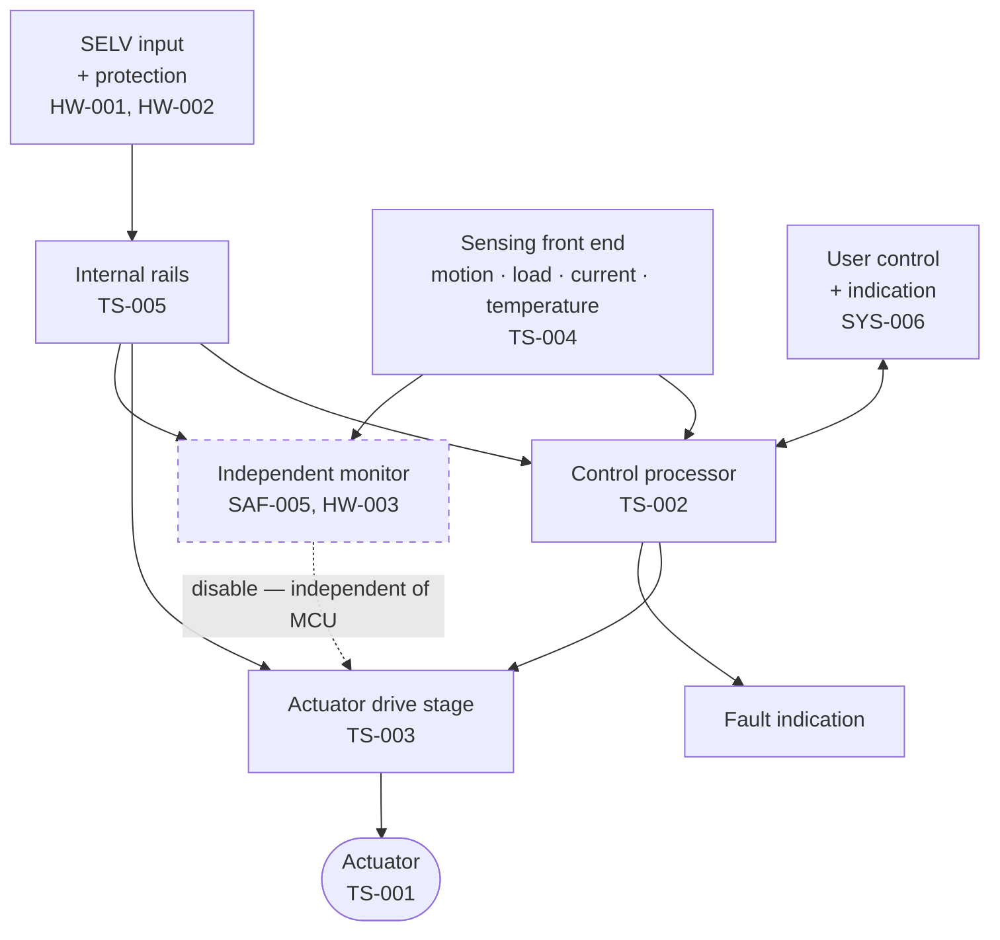

# ECU block diagram

!!! warning "Deliberately generic — Phase 4 fills this in"
    No block below names a part, a technology or a topology. That is not an omission: the
    [trade studies](../05-trade-studies/index.md) have not run. A block diagram drawn with real
    part names now would quietly become the specification.

## Functional blocks

## Blocks

| Block | Purpose | Decided by |
|---|---|---|
| SELV input + protection | Accept external 12 V; survive reverse polarity, over-voltage, shorts | [HW-001](../01-requirements/srs-electrical.md#hw-001), [HW-002](../01-requirements/srs-electrical.md#hw-002) |
| Internal rails | Generate logic and analogue supplies | [TS-005](../05-trade-studies/TS-005-power-supply.md) |
| Control processor | Estimation, control loop, user interface, faults | [TS-002](../05-trade-studies/TS-002-mcu-selection.md) |
| Actuator drive stage | Convert commands to actuator power | [TS-003](../05-trade-studies/TS-003-motor-driver.md) |
| **Independent monitor** | Amplitude limit and drive disable, without the processor | [HW-003](../01-requirements/srs-electrical.md#hw-003) |
| Sensing front end | Motion, load/occupancy, current, temperature | [TS-004](../05-trade-studies/TS-004-sensing-approach.md) |
| Actuator | Inject energy into the oscillator | [TS-001](../05-trade-studies/TS-001-actuation-concept.md) |
| User control + indication | Physical dial, state and fault indication | [SYS-006](../01-requirements/srs-system.md#sys-006) |

## The one structural commitment

The **independent monitor** is drawn as a separate block with its own path to the drive stage, and
its own access to sensing. That separation is required by
[SAF-005](../01-requirements/safety-requirements.md#saf-005) and
[SW-003](../01-requirements/srs-software.md#sw-003): a limit that shares state and timing with the
loop it constrains fails at the same moment the loop does.

This is the only architectural commitment made before Phase 4, and it is made because it constrains
the MCU trade study rather than following from it. [TS-002](../05-trade-studies/TS-002-mcu-selection.md)
must therefore evaluate candidates on how cleanly they support an independent disable path — a
criterion that would be easy to forget if this block were merged into the processor.

## Not yet addressed

Grounding and return-current strategy · EMC filtering and shielding
([HW-004](../01-requirements/srs-electrical.md#hw-004)) · thermal paths
([SAF-006](../01-requirements/safety-requirements.md#saf-006)) · connectors and cable entry ·
programming and test access · board partitioning and mechanical mounting inside the housing.
