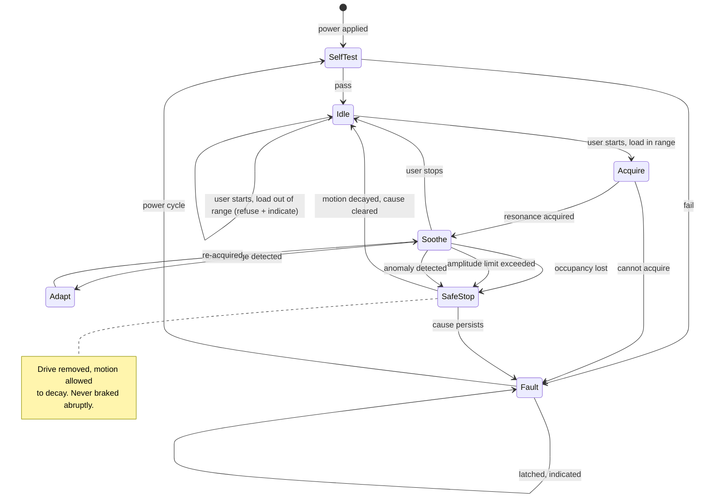

# Operating modes

!!! note "Phase 0 seed — the state machine is designed in Phase 4"
    The states below follow from the requirements that already exist. Transitions marked **?** are
    genuine open decisions, not omissions.

## States

## State definitions

| State | Drive | Meaning |
|---|---|---|
| **SelfTest** | off | Verifying sensing, the drive-disable path and the monitor before any motion |
| **Idle** | off | Powered, not driving. The resting state |
| **Acquire** | limited | Determining the resonant frequency of the present load |
| **Soothe** | on | Sustaining amplitude at the user's setting — the working state |
| **Adapt** | on | Re-acquiring after a load change ([SYS-010](../01-requirements/srs-system.md#sys-010)) |
| **SafeStop** | off | Commanded stop; motion decays naturally |
| **Fault** | off, latched | Something is wrong; user intervention required |

## Design rules

**Every fault path leads to drive removed.** Stopping is always safe in this product — there is no
continued-operation obligation. This is what makes the safety argument tractable
([SW-002](../01-requirements/srs-software.md#sw-002)).

**SafeStop lets motion decay; it does not brake.** Actively arresting a loaded hammock applies a
large force to the load path and to the occupant. Removing energy and letting damping do the work
is both safer and simpler. This is a deliberate choice worth stating, since "emergency stop"
normally implies the opposite.

**Fault is latched.** A fault that clears itself hides the failure, and hiding a failure over a
sleeping infant is not acceptable — even at the cost of waking a parent
([UC-7](../00-product/personas-and-use-cases.md#uc-7-something-goes-wrong-at-0300)).

**The monitor can force SafeStop from any state**, independently of the controller
([SAF-002](../01-requirements/safety-requirements.md#saf-002),
[SAF-005](../01-requirements/safety-requirements.md#saf-005)). It is not drawn as a transition
because it is not part of the controller's logic — that is the point of it.

## Open decisions

**? Auto-resume after power restoration.** [SAF-008](../01-requirements/safety-requirements.md#saf-008)
requires *defined* behaviour, deliberately without saying which. Resuming silently over an
unwatched baby is questionable; staying off after a two-second glitch fails
[UN-001](../00-product/user-needs.md#un-001) at 3 a.m. Needs a Phase 3 ADR.

**? Refusing to start.** Should an out-of-range load be a refusal (indicate and stay Idle) or a
fault (latch)? A parent whose 19 kg toddler is refused needs to understand why, not see an error.

**? Acquire visibility.** Resonance acquisition may involve motion the parent did not ask for.
Whether that is acceptable over a sleeping baby, and how brief it must be, is unresolved.

**? Fault clearing.** Power cycle only, or a deliberate user action? Power cycling in the dark
means unplugging something above a sleeping infant.
