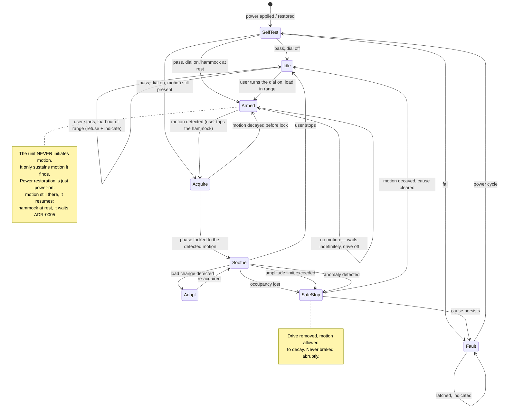

# Operating modes

!!! note "Phase 0 seed — the state machine is designed in Phase 4"
    The states below follow from the requirements that already exist. Transitions marked **?** are
    genuine open decisions, not omissions.

!!! warning "Acquire reflects a candidate architecture, not an accepted decision"
    The `Acquire` state below assumes **tap-to-start**: the user excites the hammock and the unit
    locks onto the motion it finds, rather than searching for resonance by driving. This is how the
    benchmark product works *(observed)* and it is recorded as a candidate in
    `brainstorming/ideas/IDEA-005-tap-to-start-user-excites-unit-sustains.md`. **It needs its own
    ADR before it is binding.** [ADR-0005](../04-decisions/ADR-0005-behaviour-on-power-restoration.md)
    is deliberately written to hold either way.

## States

## State definitions

| State | Drive | Meaning |
|---|---|---|
| **SelfTest** | off | Verifying sensing, the drive-disable path and the monitor before any motion |
| **Idle** | off | Powered, not driving. The resting state |
| **Armed** | off | Switched on and watching for motion, but not driving. Waits indefinitely |
| **Acquire** | off | Motion has been detected; measuring its period and phase before injecting energy |
| **Soothe** | on | Sustaining amplitude at the user's setting — the working state |
| **Adapt** | on | Re-acquiring after a load change ([SYS-010](../01-requirements/srs-system.md#sys-010)) |
| **SafeStop** | off | Commanded stop; motion decays naturally |
| **Fault** | off, latched | Something is wrong; user intervention required |

## Design rules

**The unit never initiates motion; it only sustains motion it finds.** This is the organising rule,
fixed by [ADR-0005](../04-decisions/ADR-0005-behaviour-on-power-restoration.md). One property
discharges several hazards at once: it cannot restart itself after a power cut
([HAZ-008](../03-safety/hazard-analysis.md#haz-008)), cannot drive an empty hammock
([HAZ-004](../03-safety/hazard-analysis.md#haz-004)), and cannot build amplitude beyond what it was
given ([HAZ-003](../03-safety/hazard-analysis.md#haz-003)). It also means **there is no acquisition
motion** — the unit never moves the hammock to find out how it responds.

**Every fault path leads to drive removed.** Stopping is always safe in this product — there is no
continued-operation obligation. This is what makes the safety argument tractable
([SW-002](../01-requirements/srs-software.md#sw-002)).

**SafeStop lets motion decay; it does not brake.** Actively arresting a loaded hammock applies a
large force to the load path and to the occupant. Removing energy and letting damping do the work
is both safer and simpler. This is a deliberate choice worth stating, since "emergency stop"
normally implies the opposite.

**Fault is latched.** A fault that clears itself hides the failure, and hiding a failure over a
sleeping infant is not acceptable — even at the cost of waking a parent
([UC-7](../00-product/personas-and-use-cases.md#uc-7-something-goes-wrong-at-0300)).

**The monitor can force SafeStop from any state**, independently of the controller
([SAF-002](../01-requirements/safety-requirements.md#saf-002),
[SAF-005](../01-requirements/safety-requirements.md#saf-005)). It is not drawn as a transition
because it is not part of the controller's logic — that is the point of it.

## Open decisions

**~~? Auto-resume after power restoration.~~ Settled** by
[ADR-0005](../04-decisions/ADR-0005-behaviour-on-power-restoration.md): the unit re-locks if motion
is still present and otherwise stays in `Armed`. A blip is distinguished from an outage by physics
rather than by a timer. Note the consequence — the hammock's **decay time is now a safety-relevant
parameter** and must come out of the Phase 2 damping work.

**? Refusing to start.** Should an out-of-range load be a refusal (indicate and stay Idle) or a
fault (latch)? A parent whose 19 kg toddler is refused needs to understand why, not see an error.

**~~? Acquire visibility.~~ Retired.** The question was whether resonance acquisition may involve
motion the parent did not ask for. Under tap-to-start it cannot: the human supplies the excitation
and the unit only ever sustains. The question dissolves rather than being answered.

**? Tap detection threshold.** Too sensitive and a passing lorry or a sibling knocking the stand
starts it; too coarse and a gentle tap is missed. This replaces the acquisition question as the
hard problem in this state, and it interacts with
[IF-002](../01-requirements/frame-interface-assumptions.md#if-002) — a compliant stand transmits
more external disturbance.

**? Discoverability.** A first-time user turns the dial, nothing happens, and concludes the unit is
broken. Persona [P2](../00-product/personas-and-use-cases.md#p2-the-occasional-caregiver) is
exactly who this fails. Needs an answer in the interface design, not just the manual.

**? Fault clearing.** Power cycle only, or a deliberate user action? Power cycling in the dark
means unplugging something above a sleeping infant.
