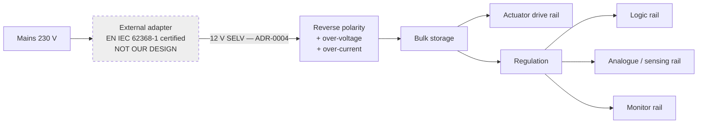

# Power tree

!!! note "Phase 0 seed — drawn for real in Phase 4, after [TS-005](../05-trade-studies/TS-005-power-supply.md)"

## Topology

**The dashed block is the scope boundary, and it is the whole point.** Mains stops at the adapter.
See [ADR-0002](../04-decisions/ADR-0002-power-input-strategy.md).

## Budget

To be filled from measurement and modelling. The average total is the binding number, since
[SYS-004](../01-requirements/srs-system.md#sys-004) is a competitive requirement derived from a
figure a competitor already advertises.

| Rail | Load | Quiescent | Average | Peak | Source |
|---|---|---|---|---|---|
| Actuator drive | Actuator | — | **TBD-P2** | **TBD-P2** | Phase 2 energy model |
| Logic | Processor, UI | TBD-P4 | TBD-P4 | TBD-P4 | After TS-002 |
| Analogue | Sensing front end | TBD-P4 | TBD-P4 | TBD-P4 | After TS-004 |
| Monitor | Independent monitor | TBD-P4 | TBD-P4 | TBD-P4 | After TS-002 |
| **Total** | | **TBD** | **≤ TBD-P2** | **TBD** | [SYS-004](../01-requirements/srs-system.md#sys-004) |

## Design notes carried into Phase 4

**Average matters more than peak.** The advertised competitive figure is a monthly energy cost, so
efficiency at the *typical* operating point dominates. A converter that is 95% efficient at full
load and 60% at the actual average draw fails the requirement while looking good on its datasheet.

**Peak current is a mechanical question.** Energy injection into a resonant system is likely
impulsive rather than continuous, so the drive rail may see a low duty cycle with high peaks. Bulk
storage sizing therefore depends on the actuation concept and cannot be settled before
[TS-001](../05-trade-studies/TS-001-actuation-concept.md).

**The monitor rail should not be a child of the logic rail.** A supervisor that browns out with the
processor it supervises does not satisfy
[SAF-005](../01-requirements/safety-requirements.md#saf-005). This constrains the rail structure,
not just the components.

**Standby draw counts.** The unit is plugged in permanently and used a few hours a night, so
standby dominates the monthly energy figure even though it is the smallest number in the table.

## Open questions

- ~~Is 12 V the right input voltage?~~ **Settled: 12 V, by [ADR-0004](../04-decisions/ADR-0004-nominal-supply-voltage.md).** Note the consequence: peak drive current is roughly double a 24 V design, which sizes the switching devices, shunt, connectors and copper.
- Does any function need to survive a brief input interruption, or is
  [SAF-008](../01-requirements/safety-requirements.md#saf-008) satisfied by a clean restart?
- Is a monitored, isolated supply for the independent monitor justified, or is a separate regulator
  from bulk sufficient?
