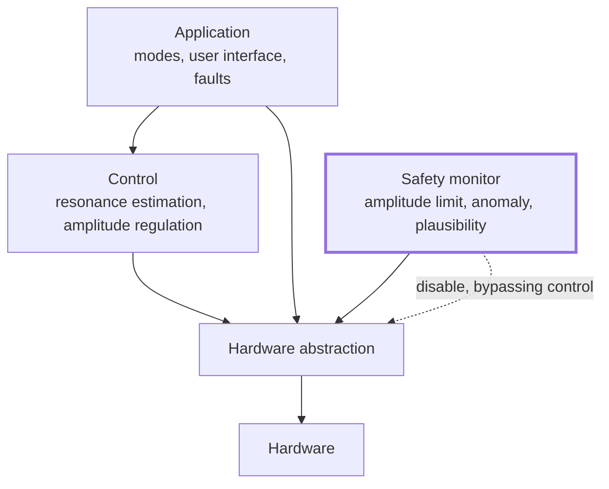

# Software architecture

!!! warning "Blocked on [TS-002](../05-trade-studies/TS-002-mcu-selection.md)"
    The processor is not chosen. This page records the **structure the requirements demand**,
    which is knowable now, and defers everything that depends on the platform — RTOS or bare
    metal, task model, drivers, build system.

## Layering

## The one rule that shapes everything

**The safety monitor is not a layer in the control stack; it is a parallel structure.**

[SW-003](../01-requirements/srs-software.md#sw-003) requires that the amplitude limit share no
state, timing or sensor processing with the loop it constrains. So the monitor:

- reads sensors through its own path, not the controller's filtered estimates
- keeps its own state, derived independently
- can remove drive without the controller's cooperation or agreement
- is small enough to be reviewed exhaustively, and changes rarely

A monitor that consumes the controller's estimate of amplitude is not a monitor — it inherits
every fault of the thing it is supposed to catch. This is the most common way this pattern is
implemented incorrectly.

## Timing

[SW-001](../01-requirements/srs-software.md#sw-001) requires deterministic control timing, because
energy injection into a resonant system is phase-sensitive: jitter becomes amplitude error.

This has an architectural consequence that is easy to get wrong. **User interaction must not
disturb the control loop.** A dial read that blocks, an indicator update that runs long, or a
fault-logging write that stalls will all show up as motion irregularity. The control path must be
isolated from anything of unbounded duration — which constrains the task model and, in turn, is a
criterion for the MCU trade study.

The timing budget itself is `TBD-P4`, since it depends on the actuation concept
([TS-001](../05-trade-studies/TS-001-actuation-concept.md)) as much as on the processor.

## Testability

Because a wrong control decision here can harm an infant, the estimation and control algorithms
should be **testable on a host machine against the Phase 2 models (`models`)**, not only on
target hardware. That argues for keeping the control and safety logic free of platform types and
direct register access — a portability discipline adopted for verification reasons rather than
aesthetic ones.

This is a genuine constraint on the MCU decision: a platform whose toolchain makes host-side unit
testing painful costs verification effort for the life of the product.

## Deliberately undecided

| Question | Blocked on |
|---|---|
| RTOS or bare metal? | TS-002 |
| Task and scheduling model | TS-002, TS-001 |
| Whether the monitor is separate firmware or separate silicon | Phase 4 architecture |
| Firmware update mechanism, if any | [ADR-0003](../04-decisions/ADR-0003-connectivity-stance.md) — no radio implies no OTA |
| Persistent settings storage | TS-002 |
| Language and toolchain | TS-002 |

## Not yet addressed

Startup and self-test sequence · fault code allocation · watchdog strategy · production test hooks ·
field diagnostics · coding standard and static analysis · unit test framework and coverage policy.
