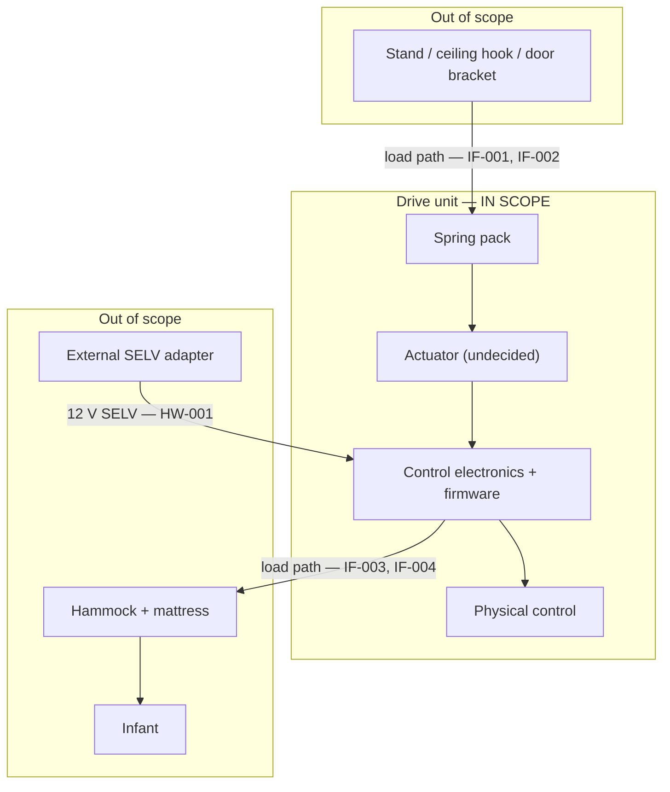
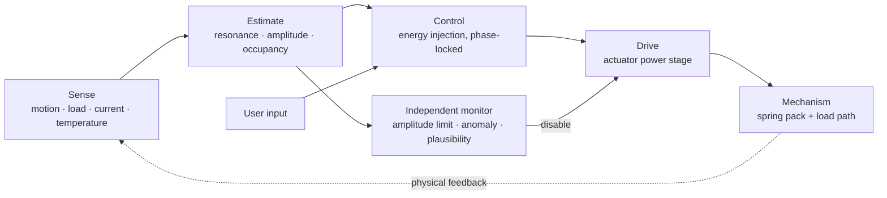

# System architecture

!!! note "Phase 0 seed"
    This page states the *physics* of the system, which is known, and marks the *implementation*,
    which is not. Nothing here commits to an actuator, sensor or processor — those are Phase 4
    outcomes of the [trade studies](../05-trade-studies/index.md).

## The system in context

Every arrow crossing the scope boundary is an [`IF-xxx` assumption](../01-requirements/frame-interface-assumptions.md)
with a tolerance band.

## The physics: a driven mass-spring oscillator

This is the fact that governs everything else. The hammock, its occupant and the spring pack form
a **vertical mass-spring system**. The drive unit injects energy each cycle to sustain oscillation
against damping.

It is **not a pendulum** and not a lateral swing. The reference product states this plainly of its
own stand: "up/down movements only, not swinging".

Three consequences follow directly:

**The resonant frequency moves with the load.** For a mass–spring system the natural frequency
falls as the square root of mass rises. Across the rated 3–18 kg range
([SYS-005](../01-requirements/srs-system.md#sys-005)) that is a factor of about 2.4 in mass, so a
meaningful shift in frequency. A fixed drive frequency cannot serve the whole range — this is why
[SYS-010](../01-requirements/srs-system.md#sys-010) exists and why some form of adaptation is
unavoidable rather than a luxury.

**Energy per cycle is set by damping, not by amplitude alone.** The actuator must replace only what
damping removes. This is why a ~5 W average draw ([SYS-004](../01-requirements/srs-system.md#sys-004))
is plausible at all despite moving a substantial mass — and why
[IF-005](../01-requirements/frame-interface-assumptions.md#if-005), the damping assumption, is the
parameter that most directly sizes the actuator. It is also the parameter we know least about.

**Resonant systems amplify, including the wrong things.** A high-Q system reaches large amplitude
from small input, which is efficient and also the mechanism behind
[HAZ-002](../03-safety/hazard-analysis.md#haz-002) and
[HAZ-003](../03-safety/hazard-analysis.md#haz-003). If the supporting structure has its own mode
near the drive band, energy pumps into it too. Efficiency and runaway are the same phenomenon.

## Functional decomposition

The **independent monitor** path is deliberately drawn separately from the control path. Per
[SAF-002](../01-requirements/safety-requirements.md#saf-002),
[SAF-005](../01-requirements/safety-requirements.md#saf-005) and
[SW-003](../01-requirements/srs-software.md#sw-003), the limit and disable path must not depend on
the correct operation of the loop it constrains. How that independence is realised — separate
hardware, a supervisor, a monitored enable line — is a Phase 4 decision.

## What is deliberately undecided

| Question | Resolved by |
|---|---|
| How is energy injected into the oscillator? | [TS-001](../05-trade-studies/TS-001-actuation-concept.md) |
| What processor runs the control loop? | [TS-002](../05-trade-studies/TS-002-mcu-selection.md) |
| How is the actuator driven? | [TS-003](../05-trade-studies/TS-003-motor-driver.md) |
| How are motion, load and occupancy sensed? | [TS-004](../05-trade-studies/TS-004-sensing-approach.md) |
| How are the internal rails generated? | [TS-005](../05-trade-studies/TS-005-power-supply.md) |
| How is monitor independence achieved? | Phase 4 architecture, after TS-002 |

## Phase 2 modelling objectives

The models (`models`) directory must produce, before any of the above can be decided:

1. Resonant frequency across 3–18 kg, for a plausible range of spring rates
2. Energy per cycle to sustain the target amplitude, versus damping ratio — the actuator sizing input
3. Amplitude sensitivity to drive phase error — sets the timing budget in [SW-001](../01-requirements/srs-software.md#sw-001)
4. Coupling behaviour with a compliant support — bounds for [IF-002](../01-requirements/frame-interface-assumptions.md#if-002)
5. Load-cycle count over product life — the input to [MEC-001](../01-requirements/srs-mechanical.md#mec-001)
