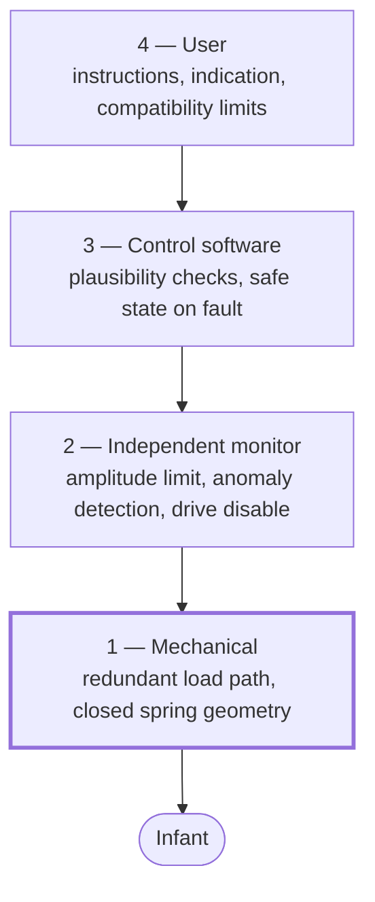

# Safety concept

How the [hazards](hazard-analysis.md) are controlled. This page states the *strategy*; the
[safety requirements](../01-requirements/safety-requirements.md) state the obligations, and Phase 4
decides the implementation.

## The governing principle

**Stopping is always safe.** There is no continued-operation obligation: a unit that stops has
failed the parent, but a unit that keeps driving with a fault can harm the infant. Every fault path
therefore leads to drive removed.

This single fact is what makes the safety argument tractable, and it is worth stating explicitly
because it is *not* true of most safety-critical systems.

## Defence in depth

Layers are ordered by how much they can be trusted, not by how they are encountered.

### Layer 1 — Mechanical, and non-negotiable

The load path must not release the load on any single failure
([SAF-001](../01-requirements/safety-requirements.md#saf-001),
[MEC-002](../01-requirements/srs-mechanical.md#mec-002)). **No electronic measure substitutes for
this.** Software cannot catch a falling baby, and this is the layer that addresses the
catastrophic hazard.

Redundant spring packs are the category norm precisely because this layer cannot be delegated
upward.

### Layer 2 — Independent monitor

An amplitude limit and anomaly detector that does not depend on the control loop
([SAF-002](../01-requirements/safety-requirements.md#saf-002),
[SAF-003](../01-requirements/safety-requirements.md#saf-003),
[SAF-005](../01-requirements/safety-requirements.md#saf-005)), with its own sensing path, its own
state, and its own ability to remove drive.

**The independence is the entire value.** A limit check that reads the controller's estimate of
amplitude inherits every fault of the thing it is meant to catch. This is the most common way the
pattern is implemented wrongly.

### Layer 3 — Control software

Plausibility checking of inputs ([SW-004](../01-requirements/srs-software.md#sw-004)) and a defined
safe state on any fault ([SW-002](../01-requirements/srs-software.md#sw-002)). This layer catches
most faults first — but it is trusted least, because it is the largest and most changeable part of
the system.

### Layer 4 — The user

Instructions, compatibility limits and fault indication. **The weakest layer**, and the design must
not lean on it. The clearest example is
[IF-002](../01-requirements/frame-interface-assumptions.md#if-002): no consumer can measure their
stand's resonant frequency, so an instruction cannot discharge that assumption — the unit must
detect the violation itself.

## Hazard coverage

| Hazard | Primary control | Layer |
|---|---|---|
| [HAZ-001](hazard-analysis.md#haz-001) load-path failure | [SAF-001](../01-requirements/safety-requirements.md#saf-001) redundant load path | 1 |
| [HAZ-002](hazard-analysis.md#haz-002) resonance coupling | [SAF-003](../01-requirements/safety-requirements.md#saf-003) anomaly detection | 2 |
| [HAZ-003](hazard-analysis.md#haz-003) excessive amplitude | [SAF-002](../01-requirements/safety-requirements.md#saf-002) independent limit | 2 |
| [HAZ-004](hazard-analysis.md#haz-004) no occupant | [SAF-004](../01-requirements/safety-requirements.md#saf-004) stop on loss of load | 2/3 |
| [HAZ-005](hazard-analysis.md#haz-005) entrapment | [SAF-007](../01-requirements/safety-requirements.md#saf-007), [MEC-003](../01-requirements/srs-mechanical.md#mec-003) | 1 |
| [HAZ-006](hazard-analysis.md#haz-006) motor runaway | [SAF-005](../01-requirements/safety-requirements.md#saf-005) independent disable | 2 |
| [HAZ-007](hazard-analysis.md#haz-007) thermal | [SAF-006](../01-requirements/safety-requirements.md#saf-006) thermal protection | 2/3 |
| [HAZ-008](hazard-analysis.md#haz-008) unexpected restart | [SAF-008](../01-requirements/safety-requirements.md#saf-008) defined state | 3 |
| [HAZ-009](hazard-analysis.md#haz-009) user alters the load path | [SAF-009](../01-requirements/safety-requirements.md#saf-009) verify configuration | 2/3 |

The [traceability matrix](../01-requirements/traceability-matrix.md) is the authoritative version
of this table and flags any hazard that loses its coverage.

## Two things this concept does not yet resolve

**What amplitude is actually safe?** [HAZ-003](hazard-analysis.md#haz-003) is mitigated by a limit
whose value is unknown. The number needs a defensible clinical or standards basis, not an
engineering guess, and it bounds the entire control design. This is the highest-value open question
in the safety work.

**No over-the-air update.** [ADR-0003](../04-decisions/ADR-0003-connectivity-stance.md) means a
firmware defect cannot be fixed remotely. The safety argument must therefore rest on
pre-release verification rather than on the ability to correct in the field — which raises the
required rigour of [verification](../06-verification/verification-plan.md) considerably.
