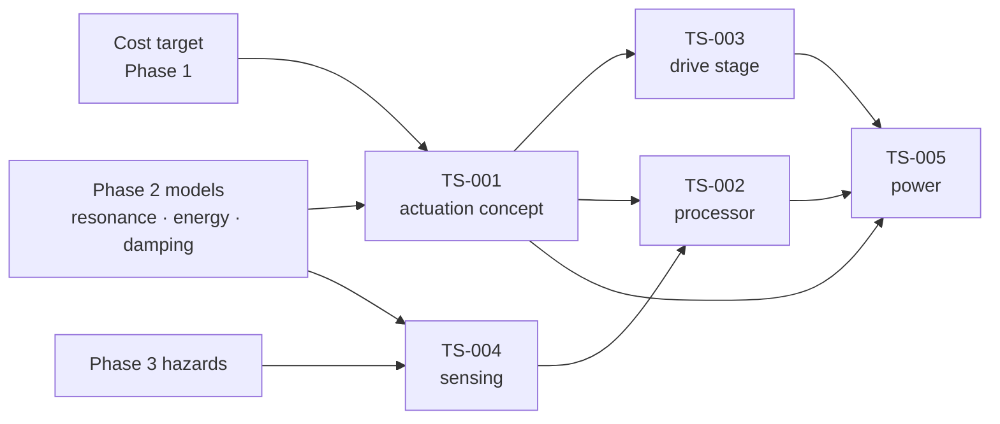

# Trade studies

Where the hardware decisions actually get made — in Phase 4, against requirements that Phase 2 and
Phase 3 have quantified.

## Register

| TS | Question | Status | Blocked on | Produces |
|---|---|---|---|---|
| [001](TS-001-actuation-concept.md) | How is energy injected into the oscillator? | open | Phase 2 models; **cost target** | an ADR |
| [002](TS-002-mcu-selection.md) | What runs the control loop? | open | TS-001; SW timing budget | an ADR |
| [003](TS-003-motor-driver.md) | How is the actuator driven? | open | TS-001 | an ADR |
| [004](TS-004-sensing-approach.md) | How are motion, load and occupancy sensed? | open | Phase 2 models; Phase 3 hazards | an ADR |
| [005](TS-005-power-supply.md) | How are the internal rails generated? | open | TS-001, TS-002, TS-003 | an ADR |

## Dependency order

**TS-001 is the keystone.** The actuation concept determines the drive stage, strongly influences
the processor and power requirements, and is the main determinant of both acoustic performance
([SYS-002](../01-requirements/srs-system.md#sys-002)) and cost. Running the others first would mean
redoing them.

## Rules

1. **Weights are set before candidates are scored.** Otherwise the study documents a decision
   already made.
2. **Every weight cites a requirement.** A criterion that traces to nothing is a preference.
3. **Every score cites evidence** — measurement, datasheet, calculation or model run.
4. **Report the sensitivity.** If the winner flips under a plausible change in one weight, that is
   the most important finding, not a footnote.
5. **A study is closed by an ADR**, not by consensus in a meeting.

## Blocking issue

**No cost target exists** ([constraints](../01-requirements/constraints.md)). TS-001 has to weigh
acoustic performance against cost, and cannot be scored without it. This is the highest-priority
Phase 1 item after [ADR-0001](../04-decisions/ADR-0001-product-positioning.md).
