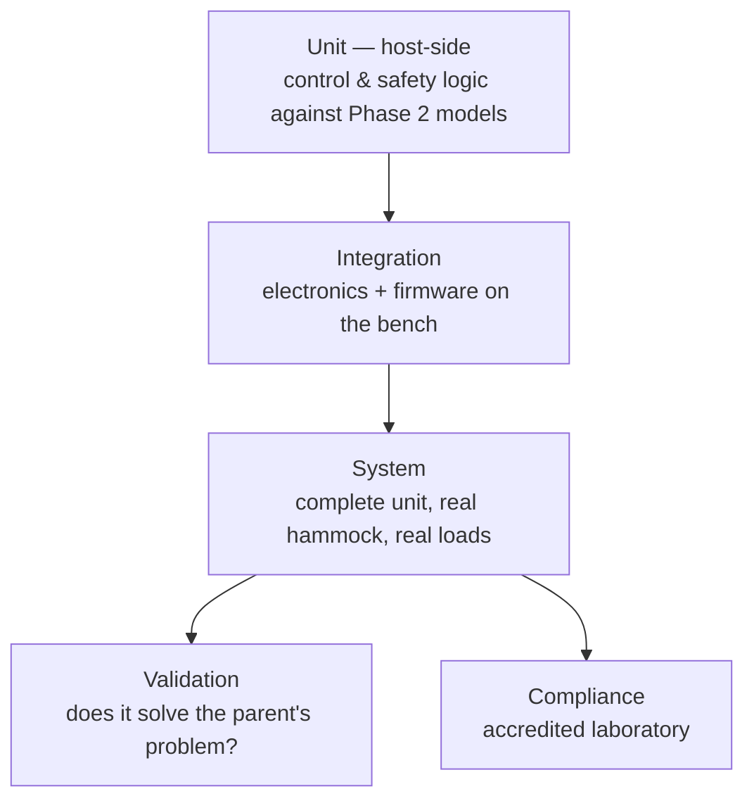

# Verification plan

Every requirement must be verifiable, and every requirement must be verified. The
[traceability matrix](../01-requirements/traceability-matrix.md) flags approved requirements with
no test case.

## Methods

| Code | Method | Use when |
|---|---|---|
| **A** | Analysis | Calculation or modelling establishes the result |
| **I** | Inspection | Direct examination against a drawing or standard |
| **T** | Test | Measurement on real hardware under controlled conditions |
| **D** | Demonstration | Observed operation, typically for usability |

Every requirement carries its method in its metadata. The linter rejects one without.

## Why this plan carries more weight than usual

[ADR-0003](../04-decisions/ADR-0003-connectivity-stance.md) rules out over-the-air updates. **A
firmware defect found in the field cannot be fixed remotely** — it requires a service action or a
recall. Verification therefore has to carry the load that OTA normally shares with it, which
justifies more pre-release rigour than the product's apparent simplicity would suggest.

## Levels

**Unit level runs on a host machine against the Phase 2 models.** That is why the
[software architecture](../02-architecture/software-architecture.md#testability) keeps control and
safety logic free of platform types — a portability discipline adopted for verification reasons.

## Specialised plans

| Plan | Why it is separate |
|---|---|
| [Acoustic](acoustic-test-plan.md) | Competitive make-or-break; needs method before a target can be set |
| [Load path](load-path-test-plan.md) | Only catastrophic hazard; needs fatigue and single-fault testing |
| [EMC pre-compliance](emc-precompliance-plan.md) | Find problems before the accredited lab, not at it |
| [Reliability](reliability-plan.md) | Continuous duty over years cannot be tested in real time |

## Safety verification rules

1. Every `SAF-xxx` needs its own test case; coverage by a functional test is not sufficient
2. Independence claims must be tested **by injecting the fault they claim to survive** — a monitor
   claimed to work without the processor is tested with the processor halted
3. Single-fault tolerance is tested by **introducing the fault**, not by analysis alone
4. Fault indication is verified as seen by a user, not as a register value

Rule 2 is the one most often skipped, and it is the only way to know whether the independence in
the [safety concept](../03-safety/safety-concept.md) is real.

## Entry criteria

Verification of a requirement may begin when it is `approved`, contains no `TBD`, and has a test
case with defined pass criteria. Testing a requirement that still contains a `TBD` verifies
nothing.
