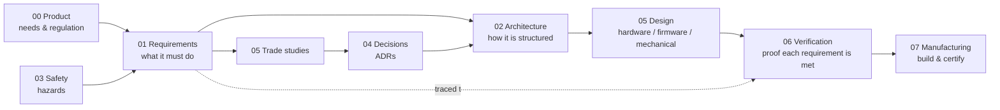

# Automatic Baby Hammock — ECU

Product development documentation for the **electronic control unit** of an automatic baby
hammock: the inline, motorised drive unit that hangs between a stand and a baby hammock and
bounces it vertically on springs (a motorised *Federwiege*).

!!! danger "Safety-critical product"
    This unit is a load-bearing structural element suspended directly above a sleeping infant.
    A load-path failure drops a baby. Read the [safety concept](03-safety/safety-concept.md)
    and the [hazard analysis](03-safety/hazard-analysis.md) before contributing to any design.

## The governing principle

**Hardware decisions are outputs of this process, not inputs to it.**

The MCU, actuator, motor driver, sensors and circuit topology are deliberately undecided. They
are chosen in Phase 4, from [trade studies](05-trade-studies/index.md), against requirements that
Phase 2 modelling has quantified. If you need a number that does not exist yet, that is a signal
to do the modelling — not to guess.

## Where to start

| If you want to know… | Read |
|---|---|
| Why this product exists | [Vision](00-product/vision.md) |
| What is and isn't being built | [Project scope](00-product/project-scope.md) |
| What the competition actually does | [Competitive benchmark](00-product/competitive-benchmark.md) |
| Which regulations apply | [Regulatory scope](00-product/regulatory-scope.md) |
| What the ECU must do | [System requirements](01-requirements/srs-system.md) |
| What can go wrong | [Hazard analysis](03-safety/hazard-analysis.md) |
| Why something was decided | [Decisions (ADR)](04-decisions/index.md) |
| **Where the project stands** | **[Project status](project-status.md)** |
| **What is still unanswered** | **[Open points](open-points.md)** |
| The formulas everything rests on | [Physics reference](02-architecture/physics-reference.md) |

## Reading the structure

The `docs/` tree is numbered to follow the V-model, so the direction of information flow is
visible in the tree itself:

## Current status

Phase 0 is complete and Phases 1–3 are in progress in parallel — product definition, physics
modelling and hazard analysis all exist in draft. No requirement is approved, no trade study is
closed and no hardware is chosen, because
[ADR-0001 — product positioning](04-decisions/ADR-0001-product-positioning.md) is still
`proposed`: it decides which harmonised standard the product is built to, and therefore what the
product physically is.

Full picture, with counts and the current blockers: **[Project status](project-status.md)**.

## Conventions

- Requirement IDs and their rules: [Requirements overview](01-requirements/index.md)
- The [traceability matrix](01-requirements/traceability-matrix.md) is **generated**; never edit it
- "Shall" means a binding requirement; "should" means a goal
- No compliance is *claimed* anywhere in these docs — only *intended*, with the verification
  that will demonstrate it
