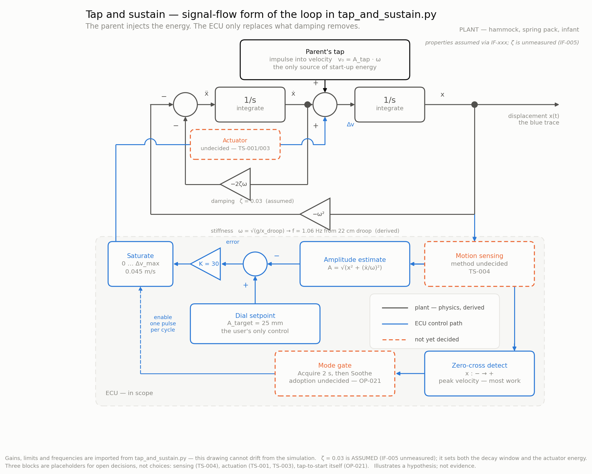

# Control loop models

## The loop as blocks



The same loop in signal-flow form, for reading the structure rather than the behaviour.
Generated by `block_diagram.py`, which **imports its numbers from `tap_and_sustain.py`**
rather than repeating them, so the drawing cannot drift from the simulation.

| Block | In the code | What it is |
|---|---|---|
| Two `1/s` integrators with `−2ζω` and `−ω²` feedback | the RK4 step on `x'' = −2ζω·x' − ω²·x` | the plant: springs, load and damping. `ω` is derived from droop; `ζ` is not |
| Parent's tap → velocity node | `v[0] = (TAP_AMPLITUDE_MM/1000)·OMEGA` | the only source of start-up energy |
| Motion sensing | *(implicit — the simulation reads the state directly)* | **undecided, `TS-004`** |
| Amplitude estimate `A = √(x² + (ẋ/ω)²)` | `np.hypot(x, v/OMEGA)` | amplitude from one sample of position and velocity, without waiting a full cycle |
| Dial setpoint → error | `TARGET_AMPLITUDE_MM/1000 − amplitude` | the user's only control |
| Gain `K`, then saturation `0 … Δv_max` | `np.clip(IMPULSE_GAIN·error, 0, IMPULSE_DV_MAX)` | proportional impulse, floored at zero — the ECU can add energy but never remove it |
| Zero-cross detect | `x[i] <= 0 < x[i+1]` | fires at maximum velocity, where a given impulse does the most work |
| Mode gate | `t[i] >= LOCK_TIME_S` | `Acquire` watches without driving, then `Soothe` |
| Actuator | *(none — the impulse is added straight to `v`)* | **undecided, `TS-001`/`TS-003`** |

Three blocks are drawn dashed because they are **positions in the loop, not choices**: the
diagram cannot be drawn without something in them, but nothing has been selected. The model
idealises two of them away entirely — it has no sensor lag, no quantisation and no actuator
dynamics, so it flatters any real implementation.

Reading it that way makes the dependency obvious: the ECU sits entirely in the *feedback* path.
It observes the plant and adds a velocity impulse; it has no authority over stiffness or damping,
and no path by which it can drive the hammock from rest — with no motion there is no zero
crossing, so the impulse never fires. That is the mechanism by which this loop would satisfy
"sustain, never initiate"
([ADR-0005](../../docs/04-decisions/ADR-0005-behaviour-on-power-restoration.md)) — in the model.
Whether a real implementation still has that property depends on the sensing decision (`TS-004`),
which is exactly one of the dashed blocks.

## Tap to start, ECU sustains


Generated by `tap_and_sustain.py`:

```bash
../../.venv/bin/python tap_and_sustain.py
../../.venv/bin/python block_diagram.py
```

### What it shows

A parent taps the hammock. The ECU watches for ~2 s without driving
(`Acquire`), locks onto the motion it finds, then injects one impulse per cycle
at maximum velocity to hold the amplitude the dial asks for (`Soothe`).

The orange trace is the **same tap with no ECU** — the counterfactual. It falls below
1 mm in about 11 s. That contrast is the product in one picture: the ECU does not
create the motion, it only stops it dying.

This is the architecture in
`brainstorming/ideas/IDEA-005-tap-to-start-user-excites-unit-sustains.md` and the
state machine in `docs/02-architecture/operating-modes.md`.

### What is derived, and what is guessed

| Quantity | Value | Status |
|---|---|---|
| Natural frequency | 1.06 Hz | **Derived** from 22 cm static droop via `f = (1/2π)√(g/x)` |
| Damping ratio ζ | 0.03 | **Assumed** — [IF-005](../../docs/01-requirements/frame-interface-assumptions.md#if-005) is unmeasured |
| Target amplitude | 25 mm | Chosen to sit in the observed 1–3 cm band |
| Tap size, lock time, impulse gain | — | **Assumed** |

**Damping is the weak point.** It sets how fast the orange curve dies, how much
energy the actuator must supply, and therefore the actuator sizing that
[TS-001](../../docs/05-trade-studies/TS-001-actuation-concept.md) depends on. Nothing
here is evidence until it is measured.

### Two things it makes concrete

**Energy per cycle is small.** The pulses only replace what damping removed, which is
why ~5 W average is plausible for a device moving a 10 kg baby. The actuator never
lifts the load — it tops up a resonant system.

**Decay time is safety-relevant.** [ADR-0005](../../docs/04-decisions/ADR-0005-behaviour-on-power-restoration.md)
says the unit resumes only if motion is still present after a power interruption. The
orange curve *is* that window: at ζ = 0.03 it stays detectable for roughly 10 s. A
lower damping ratio widens the window in which an unattended restart can happen —
which is exactly why ζ has to be measured rather than assumed.

### Why proportional, not on/off

Impulse size is proportional to amplitude error, so the motor runs **every cycle** and
simply does less work as the target is approached. A fixed impulse with cycle-skipping
reaches the same amplitude but pulses irregularly — which would not match the observed
*soft whir once per bounce cycle*. The control rule was chosen to fit the observation.

### To validate

Measure droop and count bounces over 60 s; predict 1.06 Hz first. Then measure the
decay: tap the hammock with the ECU off and time how long visible motion lasts. That
single measurement fixes ζ and turns this figure from illustration into a calibrated
model.
